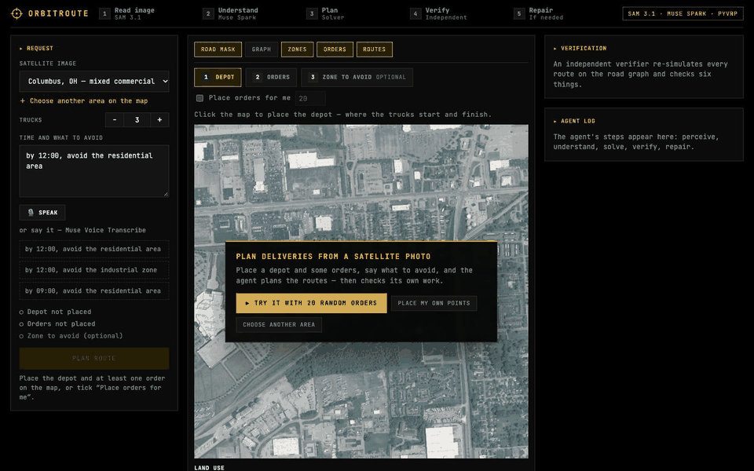
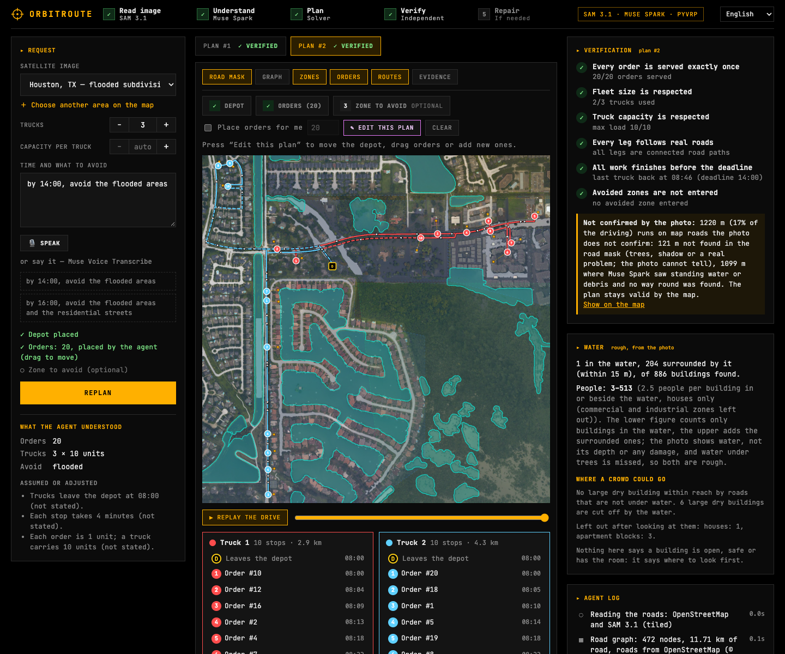
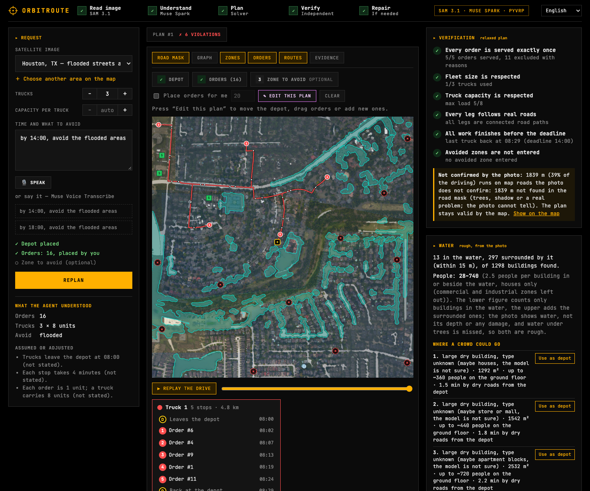
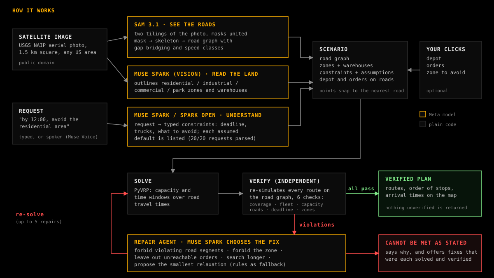
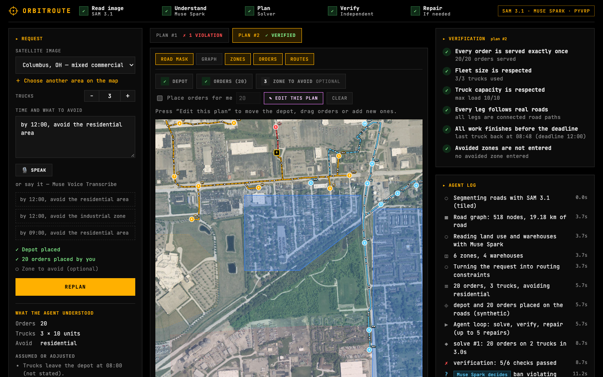

# OrbitRoute

**Give it a satellite photo and one sentence. It plans the deliveries, proves the plan is valid, and repairs it when it is not.**

Built solo for the Meta Global AI Developer Hackathon (track: Push the Frontier, Indie). Everything in this repository was written during the event.



## The problem

Routing engines assume a map. Where the map is missing or out of date (a new district, a place a storm just changed), the road network has to be read from an aerial photo, and a delivery plan built on top of it can quietly break the rules it was given: it drives through the zone it was told to avoid, finishes after the deadline, overloads a truck. Nobody notices until the trucks are out.

OrbitRoute reads the roads from the photo, turns a plain-English request into constraints, plans the routes, and then **checks its own plan with a verifier that does not trust the solver or the language model**. If the plan breaks a rule it repairs it and solves again; if the request cannot be met it says so and offers fixes that were each solved and verified.

## Navigators know the map. A flood changes it.

A routing engine knows the roads as they were before the water came. An aerial photo taken during the flood shows what is passable now. OrbitRoute's disaster samples are real NOAA Emergency Response Imagery of Hurricane Harvey over west Houston (30 August 2017, public domain): ask it to "avoid the flooded areas" and SAM 3.1 finds the standing water on the photo, the water becomes zones the trucks must not enter, and the same verifier checks the plan against them.



- **The map is wrong where it matters.** On the second photo, **34% of the named streets in OpenStreetMap (9.1 of 27 km) lie under water** and the road graph reads only 12% of them as road, because the water hides them. A router that trusts the map would send trucks down all of them; the water zones keep the agent out (`eval/FLOOD.md`). On the first photo it is 7% of the mapped streets and service roads (2.0 of 28.5 km).
- **When the water cuts orders off, the agent says so.** With orders clicked freely over the flooded photos, the plain solver's first plan crossed the water in **8 of 8** scenarios; the agent caught all 8. In the one below, 12 of 16 orders cannot be reached without entering the water, so it offers a verified plan for the 4 that can be served now (the cut-off ones are marked with × and listed), next to the option of driving through the water, which it labels as exactly that.



Limits, stated plainly: NOAA says this imagery is not intended for navigation, so this is a demonstration, not an emergency tool; SAM sees standing water, not its depth, and muddy street water under trees is the hardest case (some flooded streets are missed); and the two photos are two 1.5 km tiles.

## What happens when you press the button

1. **See.** SAM 3.1 segments the roads in two overlapping tilings of the photo; the masks are united, skeletonised and turned into a road graph (nodes, gap bridging, speed class from road width). It also finds the buildings: when the agent places the orders, they are delivery addresses (a house, served from the nearest road the trucks may use), not random points.
2. **Understand.** Muse Spark reads the request ("by 12:00, avoid the residential area") into typed constraints and lists every default it had to assume. Muse Spark vision outlines land-use zones and warehouses on the photo; if the request says to avoid floods, SAM also finds the standing water.
3. **Plan.** PyVRP solves a capacitated routing problem with time windows over travel times on the road graph.
4. **Verify.** An independent verifier re-simulates every route edge by edge on the road graph and runs six checks: every order served exactly once, fleet size, truck capacity, legs follow real roads, deadline, avoided zones not entered.
5. **Repair.** On a violation, Muse Spark chooses one action (forbid the violating road segments, forbid the whole zone, leave out unreachable orders, search longer, or give up and propose relaxations); a deterministic policy is the fallback. The loop is bounded to five repairs and logs every step. When the request cannot be met, every alternative it offers was solved and verified (move the depot to where the orders are, serve only the reachable orders, more trucks, a later deadline, and last of all drive through the zone), and Muse Spark recommends one with a reason. A rule stops it from recommending to drive through a forbidden zone while any other option exists.



The agent returns **only plans that passed verification**, or an honest report: which orders cannot be reached, which constraint cannot be met, and the smallest changes that would work, each already solved and verified.

## Meta models used

| Model | Where | What it does |
|---|---|---|
| **SAM 3.1** (`sam-3.1`, Meta Model API) | perception | finds the roads on the photo (the only roads the agent routes on), the buildings (delivery addresses) and, after a storm, the standing water |
| **Muse Spark 1.3** (Meta Model API) | vision, request parsing, repair | outlines zones and warehouses, parses the request into JSON constraints, chooses repair actions, recommends one of the verified alternatives |
| **Muse Spark Open** (open weights, served by Baseten and, as a backup, by a Modal Endpoint) | request parsing, repair | the same text steps on open weights: set `REASONING_PROVIDER=baseten` (or `modal`) |
| **Muse Voice Transcribe** | request box | speak the request instead of typing it |

## Does it work? The numbers

Everything below is produced by scripts in `scripts/` and written to `eval/`; nothing is hand-edited.

**How good are the roads?** The graph SAM produces was compared with OpenStreetMap on both bundled 1.5 km tiles (`eval/ROADS.md`; OSM is only a yardstick here, © OpenStreetMap contributors, ODbL). Within 15 m, **86-91% of the graph lies on a real mapped road** and it covers **73-86% of the named streets** (48-53% when every service road is counted; parking aisles and driveways are mostly invisible at this resolution). One 6x6 tiling found 66% of the named streets; no other SAM prompt ("street", "driveway", "alley", "paved road") added anything, while uniting a 6x6 and a 12x12 tiling reached 77% at the same precision.

**Does the verifier earn its keep?** 62 fixed scenarios on four photos (`eval/RESULTS.md`, `scripts/run_eval.py`). Eighteen draw a zone at each point of a fixed 3x3 grid and place orders only where a legal route can reach them; eighteen use the same zones but place the orders anywhere, the way a user clicking freely does (some are then cut off by the zone); ten use zones found by Muse Spark, four of them requests that are infeasible by arithmetic; sixteen are flood relief on the two Hurricane Harvey photos, with the water found by SAM.

- The plain solver's first plan broke a rule in **3 of 18** grid scenarios and **0 of 8** reachable flood scenarios, but in **16 of 18** and **8 of 8** when orders were placed freely. Across all 62, the solver called 57 plans feasible and the audit found **28 of them (49%) broke a constraint**, all of them avoided-zone violations.
- The audit is a second implementation of the checks, written separately from the verifier the agent runs (exact shapely geometry on the route polylines, `verifier/independent.py`). The two gave the same verdict on **all 124 plans checked** (the first and the returned plan of every scenario), and on every corrupted plan in the differential tests.
- The agent returned **zero invalid plans**. Of the 33 scenarios whose first plan was invalid, **13 ended verified automatically** (4 by re-routing around the zone; 9 by leaving 1-5 cut-off orders out, each listed with its reason, never silently dropped) and **20 were flagged as impossible as stated, each with a verified way out**: the 4 provably infeasible requests, the freely placed flood scenarios where the water cuts off most orders, and other cut-off cases. In those it offers to move the depot, serve the reachable orders, add trucks, extend the deadline or, last, drive through the zone.
- Muse Spark parsed **20/20** free-form requests exactly (author-written phrasings; about 2.3 s each), and 24/24 once four flood phrasings were added. The open-weight Muse Spark Open does the same, after the prompt was tightened (11/20 with the first prompt).
- As the repair planner, Muse Spark chose the same actions as the deterministic policy in 6/6 runs (about $0.004 per run): in this suite it adds readable explanations, not different decisions.

## Try it



Pick a bundled sample (Columbus, Memphis, or the two flooded Houston photos) or any 1.5 km square in the United States on the map, then either press **Try it with 20 random orders** or place the depot, the orders and a zone to avoid by clicking. Set the number of trucks, type or speak what to avoid, and plan. Afterwards you can replay the drive truck by truck, drag any point and replan, and open any plan the agent tried to see what failed and why.

```bash
uv sync
cp .env.example .env                 # then set MODEL_API_KEY (and BASETEN_API_KEY for the open-weight path)
cd frontend && npm install && npm run build && cd ..
uv run uvicorn orbitroute.api:app --app-dir backend --port 8000     # http://localhost:8000
```

For development with hot reload run `npm run dev` in `frontend/` (http://localhost:5173) next to the API. Tests: `uv run pytest` (backend) and `npm test` in `frontend/`.

## Safeguards for a public demo

Model calls cost money, so every one goes through a budget guard: required token caps, a persistent spend counter per provider with a hard cap, a per-run cap, and a kill switch (`DEMO_PAID_CALLS_ENABLED=false`). Runs are limited per IP and per day, at most 3 run at once, new map areas (about $0.45 of SAM calls each) are limited more tightly, and voice clips are capped at 60 s. The two bundled samples ship with pre-computed SAM and zone answers (`data/prewarmed/`), so a fresh server pays nothing for them. A run is abandoned as soon as the browser disconnects, so closing the tab stops the spending. Behind a reverse proxy the caller's address is taken from the right side of `X-Forwarded-For` (`TRUST_PROXY`, `TRUSTED_PROXY_HOPS`), uploads are cut off at their limit while they stream in, and stored map areas are capped. API keys live only in `.env` on the backend. Usage per provider: `/api/usage`.

## Honest limits

- The road graph is trustworthy but incomplete (see above): it finds the street network, not every alley, and dense, tree-covered blocks lose streets. "Real roads" in the verifier means roads in this graph.
- Zone outlines come from Muse Spark and have no human-labelled ground truth; `eval/GROUNDING.md` measures how stable they are across repeated answers, not whether they are right.
- The audit in the evaluation is a second implementation that agrees with the verifier on every plan, but both were written by the same author, so a shared misunderstanding of a rule would pass both. Orders are building centres found by SAM, with neighbouring roofs sometimes merged, and the road graph is still incomplete.
- Truck capacity is not asked for: a default is assumed and listed with every other assumption. Every order is one unit and each truck makes one trip.
- US imagery only (USGS NAIP, and NOAA storm photos for the two disaster samples). The evaluation covers two tiles and author-written requests; it measures robustness, not performance in the wild.
- The microphone path is verified against the server with a real recording, not yet across browsers.

## Under the hood

- **Prompts are versioned files** in `backend/orbitroute/prompts/` (`scene`, `request`, `repair`; `active.json` picks the version), compared on real runs. Request prompt v2 took the open-weight model from 11/20 to 20/20 exact parses; scene prompt v2 is more stable on the current tiles (76% vs 65% agreement over three repeats) but v1 stays active because every number above was produced with it.
- **Open weights with a safety net:** text steps run on Muse Spark Open, first on Baseten, then, if that fails or its separate budget runs out, on a Modal shared Endpoint serving the same open weights, and only then on the Meta API. Each provider has its own spend counter and cap.
- **Interface:** an "Instrument" design system (black canvas, amber accent, hairlines, square corners, self-hosted JetBrains Mono under the OFL) so the photo and the routes carry the colour.
- **Everything is streamed:** FastAPI sends each agent step as a server-sent event; the UI shows it live.

```
backend/orbitroute/
  perception/    SAM tiling, road mask -> graph, flood water -> zones, buildings -> addresses
  storm.py       NOAA storm photos from web-map tiles
  understanding/ request parsing, zone grounding
  routing/       scenario, cost matrices, PyVRP solver
  verifier/      the six checks, plus a second implementation used to audit it
  agent/         solve -> verify -> repair loop, relaxations
  llm/           Meta / Baseten client, budget guard
  eval/          scenario and parsing evaluation
frontend/        React + TypeScript + Leaflet interface
scripts/         evaluation, data and README-asset scripts
eval/            generated results (RESULTS.md, ROADS.md, GROUNDING.md)
data/            sample images, pre-computed answers, sources
```

## Data sources and licenses

See [data/SOURCES.md](data/SOURCES.md). Imagery: USGS NAIP and NOAA Emergency Response Imagery (both public domain). The map search uses OpenStreetMap's Nominatim and OpenStreetMap data is used only to measure road accuracy: © OpenStreetMap contributors (ODbL). Fonts: JetBrains Mono (OFL).

## License

MIT, see [LICENSE](LICENSE).
