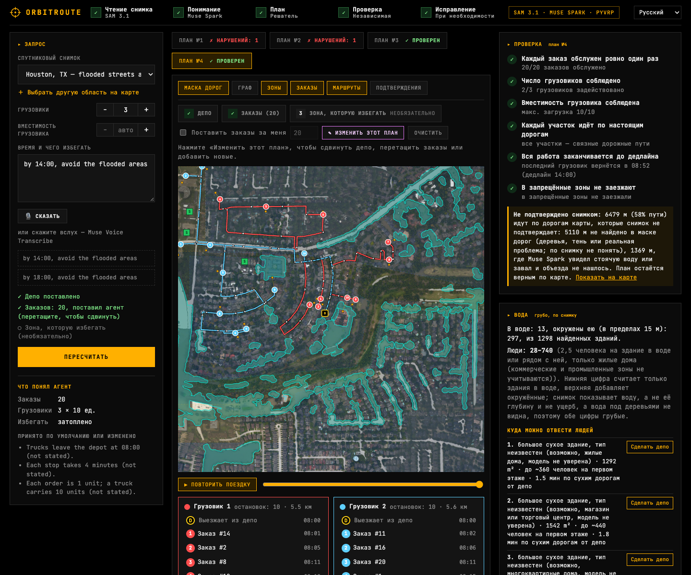

# OrbitRoute

**Give it a satellite photo and one sentence. It plans the deliveries, proves the plan is valid, and repairs it when it is not.**

Built solo for the Meta Global AI Developer Hackathon (track: Push the Frontier, Indie). Everything in this repository was written during the event.


## The problem

Routing engines assume a map, and a delivery plan built on a map can quietly break the rules it was given: it drives through the zone it was told to avoid, finishes after the deadline, overloads a truck. Nobody notices until the trucks are out. And the map is only what was mapped: it knows nothing of the dirt road, of the street a storm just put under water, of the district that is not on it yet.

OrbitRoute takes the roads from OpenStreetMap and uses an aerial photo as evidence of what is still there (which roads the photo confirms, where water stands, which large dry buildings a crowd could go to; with no map to use it reads the roads from the photo), turns a plain-English request into constraints, plans the routes, and then **checks its own plan with a verifier that does not trust the solver or the language model**. If the plan breaks a rule it repairs it and solves again; if the request cannot be met it says so and offers fixes that were each solved and verified.

## Navigators know the map. A flood changes it.

A routing engine knows the roads as they were before the water came. An aerial photo taken during the flood shows what is passable now: the roads come from the map, and the photo says where the water stands. OrbitRoute's disaster samples are real NOAA Emergency Response Imagery of Hurricane Harvey over west Houston (30 August 2017, public domain): ask it to "avoid the flooded areas" and SAM 3.1 finds the standing water on the photo, the water becomes zones the trucks must not enter, and the same verifier checks the plan against them.


- **The map is wrong where it matters.** On the second photo, **34% of the named streets in OpenStreetMap (9.1 of 27 km) lie under water** and the road graph read from the photo alone found only 12% of them as road, because the water hides them. A router that trusts the map would send trucks down all of them; the water zones keep the agent out (`eval/FLOOD.md`, measured on the photo-only graph). On the first photo it is 7% of the mapped streets and service roads (2.0 of 28.5 km).
- **When the water cuts orders off, the agent says so.** With orders clicked freely over the flooded photos, the plain solver's first plan crossed the water in **8 of 8** scenarios; the agent caught all 8. In the one below, 11 of 16 orders cannot be reached without entering the water, so it offers a verified plan for the 5 that can be served now (the cut-off ones are marked with × and listed), next to the option of driving through the water, which it labels as exactly that.


Limits, stated plainly: NOAA says this imagery is not intended for navigation, so this is a demonstration, not an emergency tool; SAM sees standing water, not its depth, and muddy street water under trees is the hardest case (some flooded streets are missed); and the two photos are two 1.5 km tiles.

## What happens when you press the button

1. **See.** The road graph comes from OpenStreetMap (© OpenStreetMap contributors, ODbL): the ways a truck can use inside the photo, dirt tracks included. SAM 3.1 segments the roads in two overlapping tilings of the photo and says which map roads the photo confirms and which it does not; standing water found by SAM marks the stretches that are under water. Where the map has too little road, or does not answer, the graph is read from the SAM mask instead (skeletonised, gaps bridged, speed class from road width). SAM also finds the buildings: when the agent places the orders, they are delivery addresses (a house, served from the nearest road the trucks may use), not random points.
2. **Understand.** Muse Spark reads the request ("by 12:00, avoid the residential area") into typed constraints and lists every default it had to assume. Muse Spark vision outlines land-use zones and warehouses on the photo; if the request says to avoid floods, SAM also finds the standing water.
3. **Plan.** PyVRP solves a capacitated routing problem with time windows over travel times on the road graph.
4. **Verify.** An independent verifier re-simulates every route edge by edge on the road graph and runs six checks: every order served exactly once, fleet size, truck capacity, legs follow real roads, deadline, avoided zones not entered.
5. **Repair.** On a violation, Muse Spark chooses one action (forbid the violating road segments, forbid the whole zone, leave out unreachable orders, search longer, or give up and propose relaxations); a deterministic policy is the fallback. The loop is bounded to five repairs and logs every step. When the request cannot be met, every alternative it offers was solved and verified (move the depot to where the orders are, serve only the reachable orders, more trucks, a later deadline, and last of all drive through the zone), and Muse Spark recommends one with a reason. A rule stops it from recommending to drive through a forbidden zone while any other option exists.


The agent returns **only plans that passed verification**, or an honest report: which orders cannot be reached, which constraint cannot be met, and the smallest changes that would work, each already solved and verified.

## Meta models used

| Model | Where | What it does |
|---|---|---|
| **SAM 3.1** (`sam-3.1`, Meta Model API) | perception | finds the roads on the photo (the only roads the agent routes on), the buildings (delivery addresses) and, after a storm, the standing water |
| **Muse Spark 1.3** (Meta Model API) | vision, request parsing, repair | the same jobs as Muse Spark Open below, used when no open-weight provider is configured or answers; the recorded zones of the four bundled photos were made by it |
| **Muse Spark Open** (open weights, served by Baseten and, as a backup, by a Modal Endpoint) | vision, request parsing, repair | outlines zones and warehouses on a new photo (it reads images; on Columbus its zones overlap the Muse Spark 1.3 ones by 0.6-0.8 IoU for residential and industrial), parses the request into JSON constraints, chooses repair actions, recommends one of the verified alternatives: set `REASONING_PROVIDER=baseten` (or `modal`) |
| **Muse Voice Transcribe** | request box | speak the request instead of typing it |

## Does it work? The numbers

Everything below is produced by scripts in `scripts/` and written to `eval/`; nothing is hand-edited.

**Which roads does a plan drive on?** Reading the roads from the photo alone turned out to be the weak part (next two paragraphs), so the graph now comes from OpenStreetMap and the photo is evidence of what is still there: SAM's road mask says which map roads it confirms, standing water marks the stretches under water, and Muse Spark looks at the longest stretches a plan drives on that the photo does not confirm (a crop with the stretch marked) and says whether it sees a clear road, standing water, debris, or cannot tell. A stretch with water or debris is made costly, so the agent plans around it when there is a way round; one it finds clear stops being a doubt; "no road visible" and "hidden by trees" stay doubts, because the model says the first one readily under tree cover and a map road is not overruled by it. Nothing is forbidden on this evidence (only the request's own "avoid" zones forbid); the report says how much of the driving the photo does not confirm. On the same 16 photos and the same random scenarios (`eval/HYBRID.md`, `scripts/eval_hybrid.py`, no model calls) the map graph has on average 38.7 km of road against 14.6 km read from the photo, **88% of random points of a photo lie within 80 m of it against 60%**, and 94 of 128 plans ended verified against 83 (0 audit failures on either). The photo confirms 47% of the map's roads, and on the map graph 41% of the driving ran on roads it does not confirm: that is the honest size of the doubt, mostly trees and shadow, not a count of blocked roads. The map is not always the better source: on the Houston subdivision photo the OpenStreetMap graph is thinner (11.7 km against 15.5 km, 42% of points within 80 m against 61%), and where the map has too little road, or does not answer, the app reads the roads from the photo as before. The tables below describe that photo-only mode.

**Dirt tracks.** A reviewer's first complaint was that reading roads from an aerial photo misses dirt roads. On three 1.5 km forest squares whose mapped roads are almost all `highway=track` (Medicine Bow NF in Wyoming, Apalachicola NF in Florida, Sam Houston NF in Texas; `eval/TRACKS.md`, `scripts/eval_tracks.py`, about $1.35 of SAM) the graph read from the photo reaches **3%, 69% and 0%** of the mapped track (0.1, 3.1 and 0.0 km of road against 4.6, 4.3 and 4.8 km on the map). On two of the three squares not a single one of 8 random scenarios could be planned on the photo graph (no road to plan on); on the map graph 2, 5 and 4 of 8 ended verified. The map graph is not a cure for forest either: only 28-32% of the points of such a square lie within 80 m of a mapped road, because the network there is sparse, and 6 of the 9 longest unconfirmed stretches were shown to Muse Spark as "hidden by trees". Looking at the crops, the two it called a clear road are visible dirt roads, the six it could not tell are dense forest, and the one it called "no road visible" crosses a clearing (a judgement call). The squares were picked because the map has tracks there, and a mapped track may be overgrown or gone, which the photo cannot always tell.

**Who is exposed, and where could a crowd go?**


When a photo shows standing water, the same buildings and water SAM already finds give a rough reading (`perception/exposure.py`). Buildings in the water and buildings within 15 m of it are counted, and from them a range of people (2.5 per building, the US household size; commercial and industrial zones left out): on the first Houston photo 13 buildings in the water and 297 surrounded by it, about 28-740 people, on the second 1 and 204, about 3-513. It is an order of magnitude, not a count: the photo shows water, not its depth inside a house, and not damage (nothing here claims destroyed buildings), and water under trees is missed. Large compact buildings (1,200-40,000 m2) that are dry and not surrounded by water, and that the trucks can reach from the depot on roads that are not under water, are listed as places to look at first, with the time by road and what they could hold on the ground floor at 3.5 m2 per person (the Sphere minimum). Muse Spark looks at each of the nearest ones and says what it is: the first photo's candidates came back as houses and flats (taken out of the list), one possible store it was only 35% sure of, and nothing it could name, so they are offered as "type unknown" with its guess; the second photo has no candidate left (one house, three blocks of flats). An OpenStreetMap school, hospital or store at the spot would name a building, but these two photos have none. A building is never said to be open, safe or to have room. "Use as depot" puts the depot there and the agent plans again. Population grids such as Kontur (400 m cells) and the Microsoft building footprints were looked at and left out: a 1.5 km square holds about ten Kontur cells, which adds little to the building count, and the buildings SAM finds are the ones standing in the photo.

**How good are the roads, read from the photo alone?** The graph SAM produces was compared with OpenStreetMap on both bundled 1.5 km tiles (`eval/ROADS.md`; OSM is only a yardstick here, © OpenStreetMap contributors, ODbL). Within 15 m, **86-91% of the graph lies on a real mapped road** and it covers **73-86% of the named streets** (48-53% when every service road is counted; parking aisles and driveways are mostly invisible at this resolution). One 6x6 tiling found 66% of the named streets; no other SAM prompt ("street", "driveway", "alley", "paved road") added anything, while uniting a 6x6 and a 12x12 tiling reached 77% at the same precision.

**Does the verifier earn its keep?** 62 fixed scenarios on four photos (`eval/RESULTS.md`, `scripts/run_eval.py`). Eighteen draw a zone at each point of a fixed 3x3 grid and place orders only where a legal route can reach them; eighteen use the same zones but place the orders anywhere, the way a user clicking freely does (some are then cut off by the zone); ten use zones found by Muse Spark, four of them requests that are infeasible by arithmetic; sixteen are flood relief on the two Hurricane Harvey photos, with the water found by SAM.

- The plain solver's first plan broke a rule in **3 of 18** grid scenarios and **0 of 8** reachable flood scenarios, but in **16 of 18** and **8 of 8** when orders were placed freely. Across all 62, the solver called 57 plans feasible and the audit found **28 of them (49%) broke a constraint**, all of them avoided-zone violations.
- The audit is a second implementation of the checks, written separately from the verifier the agent runs (exact shapely geometry on the route polylines, `verifier/independent.py`). The two gave the same verdict on **all 124 plans checked** (the first and the returned plan of every scenario), and on every corrupted plan in the differential tests.
- The agent returned **zero invalid plans**. Of the 33 scenarios whose first plan was invalid, **13 ended verified automatically** (4 by re-routing around the zone; 9 by leaving 1-5 cut-off orders out, each listed with its reason, never silently dropped) and **20 were flagged as impossible as stated, each with a verified way out**: the 4 provably infeasible requests, the freely placed flood scenarios where the water cuts off most orders, and other cut-off cases. In those it offers to move the depot, serve the reachable orders, add trucks, extend the deadline or, last, drive through the zone.
- Muse Spark parsed **20/20** free-form requests exactly (author-written phrasings; about 2.3 s each), and 24/24 once four flood phrasings were added. The open-weight Muse Spark Open does the same, after the prompt was tightened (11/20 with the first prompt).
- A larger CPU-only suite (`eval/BIG_SUITE.md`, `scripts/eval_big_suite.py`): 400 random scenarios on the four photos (random zone, 8-60 orders, 1-6 trucks, deadlines, sometimes a stated capacity). Of 312 first plans the solver called feasible, **175 (56%) broke a rule**; **none of the 243 returned verified plans failed the audit**, the other 157 scenarios ended with verified alternatives, and the verifier and the audit never disagreed over 800 plans. The suite also exposed a gap that is now fixed: when capacity alone needed more trucks than the search tried, no alternative was offered.
- Harder phrasings (capitals, "half past", "quarter to", 17h, other units, stray detail, no time at all) were parsed **20/20** exactly by Muse Spark, Muse Spark Open on Baseten and on Modal (`eval/PARSING_HARD.md`; phrasings written by the author).
- When several verified alternatives exist, the model recommends one under a safety rule: on the 20 evaluation scenarios that end with alternatives it chose the same option as the rules in **20/20** on all three providers and **never** recommended driving through a forbidden zone when a safe option existed (`eval/RECOMMEND.md`).
- A soak test of 150 random runs through the real API (bundled photos, 20 sentences some odd on purpose, 1-8 trucks, random clicked points and zones, and deliberately broken input; `scripts/soak.py`) ended in no unexpected error and no crash: every run either returned a result or refused with a clear message.
- As the repair planner, Muse Spark chose the same actions as the deterministic policy in 6/6 runs (about $0.004 per run): in this suite it adds readable explanations, not different decisions.

**How good are the roads in other places?** The two bundled tiles are open suburban land, which is the easy case. The same measurement on twelve 1.5 km squares across the United States (`eval/CITIES.md`, `scripts/eval_cities.py`) found on average **47% of the named streets at 95% precision** with the default tiling. It ranges from 90% (Mesa, a suburban grid) and 86% (an industrial area) to 4% in downtown Chicago and 18-20% in Portland and Brooklyn: dense blocks, shadows and tree cover hide streets from an aerial photo, and extra tilings do not bring them back. Uniting a third tiling raises the mean to about 61% for roughly $0.50-$0.70 instead of $0.45 per new area; the default stays at two tilings. When the graph is thin (under 4 km of road per km²) the interface says so before planning.

**Does flood detection work beyond Harvey?** The same two SAM prompts were run on 12 squares from five other disasters (Florence, Ian, the 2025 Texas flood, Helene) and on places where the water is permanent (`eval/FLOOD_EVENTS.md`, contact sheet `docs/flood-events.jpg`). Flooded woods, ponds, flooded lots, river corridors and scoured channels are outlined where the photo shows water; canals and harbours are found too, and over wide open water the outline is blocky with gaps. There are no ground-truth labels: this is a by-eye check of the sheet, not an accuracy figure.

**Does it read requests in other languages?** The same ten requests (deadline, trucks, orders, what to avoid, start time, minutes per stop, no time at all) were written in English, Russian, Spanish, French, German and Portuguese and parsed by Muse Spark 1.3 and by Muse Spark Open on Baseten and on Modal (`eval/PARSING_LANGUAGES.md`, `scripts/eval_parse_languages.py`, about $0.75). Exact matches: 7-9 of 10 in every language against 8-9 in English, so the language costs about nothing. The misses are the same kinds as in English (a truck count that was not given gets assumed, "quarter to six" read as no deadline once) plus one that is German only: all three models read "Gewerbegebiet" (a trade or commercial area) as industrial. The ten requests are written by the author.

**How much of a plan drives on roads the photo does not show?** The graph builder joins pieces of found road with straight links across gaps (trees, shadows) so that the network stays connected. Those links are guesses. The verifier now reports how much of a plan runs on them (links over 30 m) and the map draws them dotted. In 8 random 20-order plans per photo the share of driving on such links averaged 12% (Columbus), 3% (Memphis), 4% (Houston, streets) and 32% (Houston, subdivision under trees). Checked against OpenStreetMap (`eval/GAPS.md`), only 28-70% of the long links lie on any mapped road, the lowest where the trees are. A second look at each link (a crop sent to SAM again, `perception/gaps.py`) confirmed 1-4 links per photo and did not raise recall, so it is not part of the pipeline; making the router avoid such links changed nothing, because without them the network falls apart. What the app does is say so: a note in the verification panel and the dotted links on the map.

## Try it


The interface is in English, Russian, Spanish, French, German and Portuguese (the selector is in the header; the page opens in your browser's language). The texts the agent writes while it works (its log, the assumptions, a violation's message, the repair options) are still English, as are the example sentences and the names of the bundled photos.



 Pick a bundled sample (Columbus, Memphis, or the two flooded Houston photos) or any 1.5 km square in the United States on the map, then either press **Try it with 20 random orders** or place the depot, the orders and a zone to avoid by clicking. Set the number of trucks and, if you know it, the capacity per truck, type or speak what to avoid, and plan. Undo takes back the last point of the step you are on; a drawn zone can be redrawn. Afterwards you can replay the drive truck by truck, drag any point and replan, and open any plan the agent tried to see what failed and why.

```bash
uv sync
cp .env.example .env                 # then set MODEL_API_KEY (and BASETEN_API_KEY for the open-weight path)
cd frontend && npm install && npm run build && cd ..
uv run uvicorn orbitroute.api:app --app-dir backend --port 8000     # http://localhost:8000
```

For development with hot reload run `npm run dev` in `frontend/` (http://localhost:5173) next to the API. Tests: `uv run pytest` (backend) and `npm test` in `frontend/`. With a key (`MODEL_API_KEY` in `.env`) everything is live: your own sentences, any US map area, voice, and Muse Spark making the repair choices.

## Run it without any key

You do not need an account anywhere to try OrbitRoute. Clone, build the interface and start the server **without a `.env`**: the app starts in demo mode and the four bundled images (Columbus, Memphis and the two flooded Houston photos) run with each of their example sentences on recorded model answers: the SAM masks, the zones, the buildings, the flood water and the understanding of every example sentence are committed in `data/prewarmed/`, so not a single model call is made. A notice in the interface says so. Your own sentences, new map areas and voice input need a key, and the app tells you that instead of failing.

```bash
uv sync
(cd frontend && npm install && npm run build)
uv run uvicorn orbitroute.api:app --app-dir backend --port 8000        # http://localhost:8000
```

Recorded runs, readable on GitHub without running anything: [`examples/runs/`](examples/runs/) holds the agent log, the six checks and the outcome of three runs (a repaired zone crossing, the flood, and orders cut off by the water). `uv run python scripts/record_runs.py` regenerates them; a test runs every bundled image with every example sentence without a key.

## Safeguards for a public demo

Model calls cost money, so every one goes through a budget guard: required token caps, a persistent spend counter per provider with a hard cap, a per-run cap, and a kill switch (`DEMO_PAID_CALLS_ENABLED=false`). Runs are limited per IP and per day, at most 3 run at once, new map areas (about $0.45 of SAM calls each) are limited more tightly, and voice clips are capped at 60 s. The four bundled photos ship with pre-computed SAM, zone, map and model-look answers (`data/prewarmed/`), so a fresh server pays nothing for them. A run is abandoned as soon as the browser disconnects, so closing the tab stops the spending. A link can be shared without sharing the credits: with `ACCESS_CODE` set, only browsers that send the code (the page asks for it) get live model calls, and everyone else still runs the bundled images with their example sentences on recorded answers (a link like `https://host/#code=...` carries the code: the part after `#` never reaches the server, its logs or a Referer header, and the page removes it from the address bar after remembering it); wrong codes are limited to 8 per caller per hour, and `PAID_CALLS_UNTIL` switches live calls off for everybody on a given date. A shared deployment starts its own spend counters with their own, much lower caps. Behind a reverse proxy the caller's address is taken from the right side of `X-Forwarded-For` (`TRUST_PROXY`, `TRUSTED_PROXY_HOPS`), uploads are cut off at their limit while they stream in, and stored map areas are capped. API keys live only in `.env` on the backend. Usage per provider: `/api/usage` (it and the spend in `/api/health` need the access code when one is set).

## Engineering, risks and plan

- [`docs/ARCHITECTURE.md`](docs/ARCHITECTURE.md): the components and how a run flows through them, the deployment as it is, three levels of scale from this MVP to about a thousand users a day (with the cost arithmetic and what breaks first), and why these technologies.
- [`docs/SWOT.md`](docs/SWOT.md): strengths, weaknesses, opportunities and threats, looked at through the way the models are used, each tied to a measurement or marked as a judgement.
- [`docs/ROADMAP.md`](docs/ROADMAP.md): who the product is for, what they get, and the steps from a demo to a service (their own imagery, their own orders, before and after, more regions, pilots), marked as plan.

## Honest limits

- The road graph comes from OpenStreetMap, so it is as good, as complete and as old as the map there (dates of the bundled extracts are in `data/prewarmed/osm_*.json`); a road the map lacks is not planned on unless the map has too little road and the graph is read from the photo, which finds the street network but not every alley (4-30% of the named streets in five of twelve places). One-way streets are mapped but not enforced: the graph is undirected, so a plan can drive against a one-way street. The map extract of an area is kept as it was first read (the dates of the bundled ones are in the files) and is never refreshed. Roads the photo does not confirm cost a little more to the router, so a request to "drive as little as possible" can get a route that is slightly longer in distance than the shortest one; the times and lengths a plan reports are the real ones. "Real roads" in the verifier means roads in this graph. The photo cannot tell a street hidden by trees from one that is gone; the model's look at a stretch is a second opinion, not ground truth (there are no labels for it, and in a dry city it also says "no road visible" about stretches that a person sees as lanes). A reading of OSM that needs the Overpass service can fail or be slow for a place nobody opened before; the bundled photos carry their extract.
- Zone outlines come from Muse Spark and have no human-labelled ground truth; `eval/GROUNDING.md` measures how stable they are across repeated answers, not whether they are right.
- The audit in the evaluation is a second implementation that agrees with the verifier on every plan, but both were written by the same author, so a shared misunderstanding of a rule would pass both. Orders are building centres found by SAM, with neighbouring roofs sometimes merged, and the road graph is still incomplete.
- Truck capacity is an optional field ("Capacity per truck", or stated in the sentence); left empty, a default is assumed and listed with every other assumption. Every order is one unit and each truck makes one trip.
- US imagery only (USGS NAIP, and NOAA storm photos for the two disaster samples). The evaluation covers two tiles and author-written requests; it measures robustness, not performance in the wild.
- The microphone path is verified against the server with a real recording, not yet across browsers.

## Under the hood

- **Prompts are versioned files** in `backend/orbitroute/prompts/` (`scene`, `request`, `repair`; `active.json` picks the version), compared on real runs. Request prompt v2 took the open-weight model from 11/20 to 20/20 exact parses; scene prompt v2 is more stable on the current tiles (76% vs 65% agreement over three repeats) but v1 stays active because every number above was produced with it. Zone accuracy was then measured against the land use mapped in OpenStreetMap on 16 photos, three runs per version (`eval/SCENE_OSM.md`, `scripts/eval_scene_osm.py`; about $1.8): the zones are the right kind on 63% (v1) and 62% (v2) of the pixels OSM labels, against 39% for a model that ignores the photo and calls everything residential. Scene prompt v3, written after seeing that parks and open green land were found only 38-41% of the time, reaches 71%. Almost all of the gain is coverage (94% of the photo gets a zone, against 82%): among the pixels that do get a zone it is right about as often as before (76% vs 77%), and parks are still found only 42% of the time. OSM land use is coarse and incomplete, so read these as a comparison between prompts, not as absolute accuracy. v3 is not active: switching it on means recording the zones of the bundled photos again and repeating the measurements made with the old ones.
- **Open weights with a safety net:** text steps run on Muse Spark Open, first on Baseten, then, if that fails or its separate budget runs out, on a Modal shared Endpoint serving the same open weights, and only then on the Meta API. Each provider has its own spend counter and cap.
- **Interface:** an "Instrument" design system (black canvas, amber accent, hairlines, square corners, self-hosted JetBrains Mono under the OFL) so the photo and the routes carry the colour.
- **Everything is streamed:** FastAPI sends each agent step as a server-sent event; the UI shows it live.

```
backend/orbitroute/
  perception/    SAM tiling, road mask -> graph, flood water -> zones, buildings -> addresses
  storm.py       NOAA storm photos from web-map tiles
  understanding/ request parsing, zone grounding
  routing/       scenario, cost matrices, PyVRP solver
  verifier/      the six checks, plus a second implementation used to audit it
  agent/         solve -> verify -> repair loop, relaxations
  llm/           Meta / Baseten client, budget guard
  eval/          scenario and parsing evaluation
frontend/        React + TypeScript + Leaflet interface
scripts/         evaluation, data and README-asset scripts
eval/            generated results (RESULTS.md, ROADS.md, CITIES.md, FLOOD.md, RECOMMEND.md, PARSING_HARD.md, GROUNDING.md)
data/            sample images, pre-computed answers, sources
```

## Data sources and licenses

See [data/SOURCES.md](data/SOURCES.md). Imagery: USGS NAIP and NOAA Emergency Response Imagery (both public domain). The map search uses OpenStreetMap's Nominatim and OpenStreetMap data is used only to measure road accuracy: © OpenStreetMap contributors (ODbL). Fonts: JetBrains Mono (OFL).

## What was built during the hackathon, and what was not

The repository was created on 26 October 2026 at 12:25 ET, just after the kickoff, and every commit is dated from that day on; no code existed before it. The idea in my application was an earlier, somewhat different version of this; the project as it stands (the verified delivery plan, the agent, the flood story) took shape during the event. **Written here, during the event:** the whole agent (request parsing, the solver wrapper, the independent verifier and the second audit, the repair loop, the relaxation options and the recommendation), the road graph builder, the flood and building perception, the provider layer with the budget guard and failover, the API and the web interface, the evaluation suite and its measurements, and the README assets. **Not written here:** open-source libraries (PyVRP, FastAPI, React, Leaflet, shapely, scikit-image, scipy, networkx, JetBrains Mono), public data (USGS NAIP, NOAA Emergency Response Imagery; OpenStreetMap only as a yardstick), and Meta's models, used through the Meta Model API, Baseten and Modal. The code was written with AI coding assistants (Claude Code) under my direction.

## License

MIT, see [LICENSE](LICENSE), with one exception: `data/prewarmed/osm_*.json` are extracts of OpenStreetMap data and stay under the ODbL (© OpenStreetMap contributors, https://www.openstreetmap.org/copyright), as `data/SOURCES.md` records.
