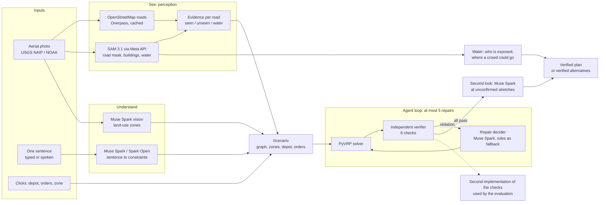

# Architecture, deployment and scaling

What OrbitRoute is made of, how it is deployed today, and how it would grow from the hackathon MVP to about a thousand users a day. What is built is marked **built**; what is only a plan is marked **plan**. Costs are measured per run (see the README) and extended by arithmetic, not by a load test: nothing here has been run at a thousand users.

## 1. Concept

An aerial photo and one sentence go in. A **verified delivery plan** (or an honest "cannot be met as stated", with alternatives that were each solved and verified) comes out. The design rule is that the part that decides whether a plan is acceptable never trusts the part that produced it:

## 2. Components (built)

| Component | Responsibility | Technology | If it fails |
|---|---|---|---|
| Interface | Request panel, map with layers, truck lists, verification card, water card, six languages | TypeScript, React 19, Vite; SVG over the photo; Leaflet only for the area picker | Static files: served from the same container as the API |
| API | `/api/run` (server-sent events), samples, areas, voice, usage, access | FastAPI, one process | A failed run ends with a message, never a silent crash |
| Roads | Graph from OpenStreetMap ways (dirt tracks included); falls back to the graph read from the SAM mask | httpx to several Overpass servers at once, first answer wins, 40 s at most; NetworkX | The roads are read from the photo instead, and the plan says so |
| Perception | Road mask (two tilings), buildings, standing water | SAM 3.1 through the Meta Model API, tiled, cached by image hash | A run on a new photo stops with a message; bundled photos are recorded |
| Evidence | Which map roads the photo confirms, which lie under water | NumPy/SciPy, shapely | Everything is "unseen": routing prefers nothing |
| Understanding | Sentence to typed constraints, land-use zones | Muse Spark 1.3, Muse Spark Open (Baseten, then Modal, then Meta) with JSON schemas | Next provider in the chain; offline demo uses recorded answers |
| Solver | Capacitated routing with time windows | PyVRP (hybrid genetic search), 1–3 s per solve | Reports infeasible; the agent proposes relaxations |
| Verifier | Re-simulates every route edge by edge: coverage, fleet, capacity, real roads, deadline, zones | Plain Python over the road graph | Cannot pass a plan it did not check |
| Audit | A second, separately written implementation (exact geometry) | shapely | Used by the evaluation: 0 disagreements over 924 plans |
| Repair agent | Chooses the fix after a violation; recommends one alternative | Muse Spark with a deterministic policy as fallback | Policy decides |
| Second look | Muse Spark looks at the longest stretches the photo does not confirm | Crops with the stretch marked, schema-constrained answers | Skipped; the plan stands as verified by the map |
| Water card | Buildings in or beside the water, rough people range, large dry buildings reachable by dry roads | SAM buildings and water, Muse Spark names the buildings | Card is omitted |
| Budget guard | Reserves every paid call before it is sent; caps per provider and per run; kill switch; deadline for live calls | Persistent counter file per provider | Refuses the call with a message |
| Access gate | Live calls only with an access code carried in the link fragment; everyone else gets the recorded demo | One header, constant-time compare, wrong-code limit | Falls back to the recorded demo |
| State | Model answers, downloaded areas, spend counters | Files on a Modal volume (committed every 15 s) | A restart loses at most a few seconds of the counter |

## 3. Deployment (built)

One container on **Modal**, defined in `modal_app.py`: the FastAPI app and the built interface together (`max_containers=1`, 2 CPU, 2 GB, 16 concurrent inputs, sleeps after 5 minutes without a request, so it costs nothing when nobody uses it). State lives on the volume `orbitroute-state`. Secrets (provider keys, access code, caps) are one Modal secret created by `scripts/make_deploy_secret.sh`; the copy shared with friends has its own, much lower caps than the project's account.

- **Recorded demo, free:** the four bundled photos with their example sentences replay recorded SAM, scene, parse, OSM and model-look answers (`data/prewarmed/`); no model is called and no account is needed (also for a fresh clone: `uv sync`, build the interface, start the server).
- **Live mode:** your own sentences, new map areas and voice, behind the access code, within caps and until a set date.
- **Checked on the deployed copy:** recorded runs without the code cost 0 $; a live run with it works; a long live run was once cut by a platform preemption and restarted by hand.
- **Delivery:** `modal deploy` from the repository; on GitHub, CI runs the backend tests (every model call is faked, no keys needed) and builds the interface.

## 4. Three levels of scale

Per-run costs measured so far: a recorded run **0 $**; a live run on a bundled photo **$0.01–0.035** (text and looks); a **new map area about $0.5** of SAM (two tilings plus buildings; $0.08 more with water), cached afterwards. Times: recorded runs 6–31 s on the deployed copy; a new area 40–90 s, dominated by the SAM calls.

| | Level 0: MVP (built) | Level 1: pilot, about 100 users a day (plan) | Level 2: about 1,000 users a day (plan) |
|---|---|---|---|
| Who | the author, friends, judges | a few organisations testing on real events | a regional service used daily |
| Runtime | 1 container, 2 concurrent runs, rate limits in memory | 2–4 containers behind the same URL | API containers + a queue + separate solver workers that scale on queue length |
| State | files on one volume | managed database for counters, limits, run history; object storage for masks and OSM extracts shared by all containers | the same, plus read replicas and per-tenant budgets |
| SAM cost control | cache per image hash | cache per map tile (a second user on the same area costs 0), pre-warm areas a customer names in advance | tile cache first; cheaper tiling for areas where the map is good (the photo only confirms); batch calls; ask the provider for a higher rate limit |
| Access | one shared code | per-organisation keys, quotas | accounts, roles, usage billing |
| Observability | request log | structured logs, error tracking, spend dashboard, alerts at 50/80% of a cap | SLOs on latency and verified-plan rate, tracing across the workers |
| Reliability | provider failover, offline demo | health checks, retries with idempotent runs, resume after preemption | multi-region read path, graceful degradation to recorded or map-only mode |
| What breaks first | spend, then the single container | the 40 s Overpass wait and SAM rate limits on new areas | SAM cost per new area and solver CPU at peak |
| Order-of-magnitude cost (estimate) | about $15 of caps for a shared copy | a few dollars a day with a warm cache | about $75 a day: 300 new areas at $0.5 with 70% already cached = $45, plus 1,000 live runs at $0.03 = $30; $2–3k a month, before any hosting |

The 1,000-a-day figure is arithmetic on measured per-run costs and an assumed 30% of users opening a new area and 70% cache hits; it has not been measured. Compute is not the first limit: two concurrent runs of about 15 s each is already about 11,000 recorded runs a day in theory, while the spend cap binds long before that.

## 5. Why these technologies

- **Python on the server.** The solver (PyVRP), the geometry (shapely, scikit-image, SciPy) and the graph code (NetworkX) are Python libraries; the time goes into the solver (1–3 s, bounded) and the model calls, not into the language, so a rewrite in another language would add risk and no speed that a user sees.
- **TypeScript and React for the interface.** Types for the data that streams in from the agent, one SVG layer over the photo for routes, zones and markers (a map library is used only to pick an area), and no runtime dependencies beyond React.
- **PyVRP for routing.** An open-source, current solver for capacitated routing with time windows with a Python API. No head-to-head against another solver was run here: the project's claims rest on the verifier and the audit, not on the solver being the best.
- **FastAPI with server-sent events.** A run is a stream of steps the interface shows as they happen.
- **Modal.** One file defines the image, the volume, the secret and the autoscaling to zero; a thousand users a day would outgrow one container but not this platform.
- **Models.** SAM 3.1 for what no map has (standing water, today's buildings, which roads are visible); Muse Spark for the sentence, the land and the second look; Muse Spark Open on two partners so that no single provider is a point of failure.

## 6. Safeguards in one place

A paid call is reserved before it is sent and recorded after; every provider has its own cap and the shared copy a lower one; live calls need the access code and stop on a set date; a run is abandoned when the browser leaves; map areas and uploads are capped; keys exist only on the server; a kill switch (`DEMO_PAID_CALLS_ENABLED=false`) closes every paid path while the recorded demo keeps working.
