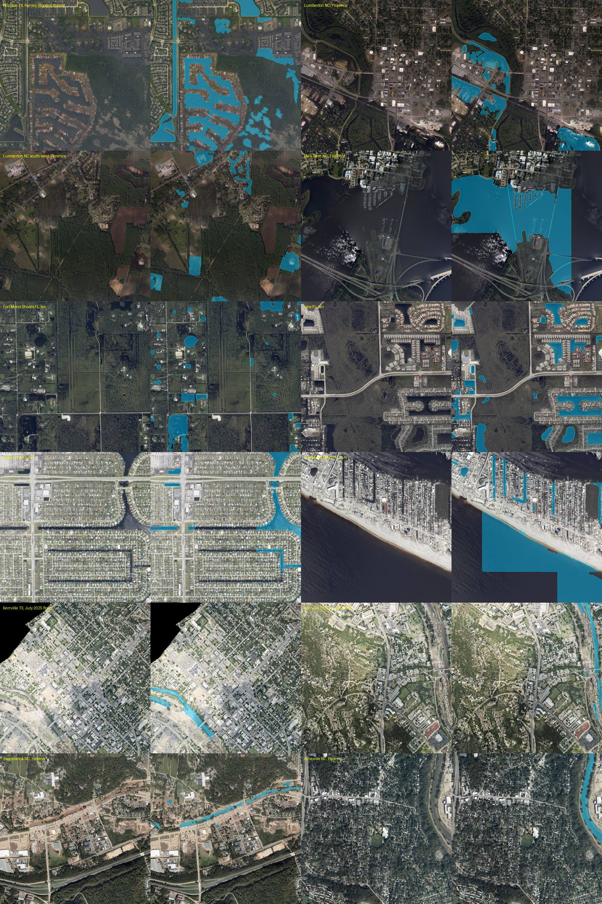

# Flood detection beyond Hurricane Harvey

Generated by `scripts/eval_flood_events.py`: the app's two flood prompts (SAM 3.1) on 1.5 km squares of NOAA Emergency Response Imagery
(public domain) from five other disasters, plus places where the water is permanent or absent. The sheet `docs/flood-events.jpg` shows
each photo (left) and the water found (right). There are no ground-truth labels: the last column is the author's reading of the photo.

| Place | Dataset | Water patches | Share of photo | What the photo shows |
|---|---|---|---|---|
| Houston TX, Harvey (flooded streets) | `20170830-rgb` | 28 | 20% | flooded streets and yards: the water is found along them |
| Lumberton NC, Florence | `20180919c-rgb` | 19 | 9% | flooded woods and an underpass at the edge of town: found |
| Lumberton NC south-west, Florence | `20180919c-rgb` | 16 | 6% | farmland: a few small pools found |
| New Bern NC, Florence | `20180919a-rgb` | 7 | 29% | river and harbour (permanent water): found, but with blocky edges |
| Fort Myers Shores FL, Ian | `20220930b-rgb` | 24 | 6% | ponds and flooded lots among dry roads: found |
| Iona FL, Ian | `20220930d-rgb` | 26 | 10% | ponds and canals found, the wet meadow is not |
| Cape Coral FL, Ian | `20220930d-rgb` | 8 | 6% | dry streets; canals (permanent water) found only in part |
| Fort Myers Beach FL, Ian | `20220930d-rgb` | 10 | 24% | gulf and canals (permanent water): found in blocks, with gaps |
| Kerrville TX, July 2025 flood | `20250712a-rgb` | 4 | 2% | dry town, scoured river bed: the channel is found |
| Kerrville TX river, July 2025 | `20250712a-rgb` | 6 | 2% | dry hills, river on the right edge: found |
| Swannanoa NC, Helene | `20241005a-rgb` | 11 | 2% | scoured stream channel and mud: found in part |
| Asheville NC, Helene | `20241006a-rgb` | 1 | 2% | river on the right edge found; the tree-covered streets are dry |

Limits: no labels, one square per place; permanent water (canals, harbours, rivers) is also found and avoided, which is the right
thing for a truck but not a flood measurement. Over large open water (New Bern, Fort Myers Beach) the result has blocky edges and gaps
where tiles end, so the share of the photo there is a lower bound; on narrow streets and yards, where trucks actually drive, the outlines follow the visible water in these 12 squares (judged by eye).
Cost: about $0.08 per new photo (answers are cached, so a rerun is free).
